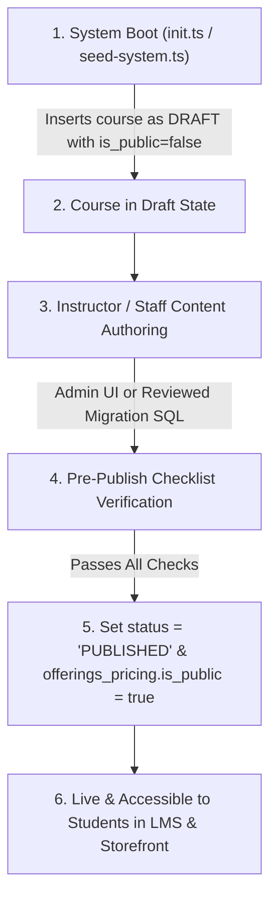

# Production Content Checklist & Deployment Safety Guide

This document defines the strict operational rules and authoring procedures for bringing new courses, modules, and learning curricula into production on the Unisole platform.

---

## 1. Environments & Database Seeding Matrix

| Seed Command / Routine | Staging | Production | Description / Intended Use |
| :--- | :---: | :---: | :--- |
| `npm run db:migrate` | ✅ Required | ✅ Required | Applies schema migrations (`Kysely`). |
| `npm run db:seed:system` (`seed-system.ts`) | ✅ Required | ✅ Required | System roles, admin users, campuses, foundational categories. In production, any new courses are seeded in `DRAFT` status. |
| `initializeDatabase()` (`init.ts`) | ✅ Required | ✅ Required | DB init, functions, triggers, partial indexes (`uq_active_user_course_enrollment`). Runs `seed_offerings_pricing` (`ON CONFLICT DO NOTHING`). |
| `seedLmsDemoData()` (`seed-lms-demo.ts`) | ✅ Enabled | ❌ **HARD-BLOCKED** | Seeds demo student Aarav Sharma, sample enrollments, mock quiz submissions, and notes. Blocked in production (`NODE_ENV === "production"`). |
| `seed:ai-agent` (`seed-ai-agent-curriculum.ts`) | ✅ Allowed (`--force`) | ❌ **HARD-BLOCKED** | Sample/staging curriculum for AI Agent Engineering and staging test student enrollments. Hard fails on production. |
| `seed:genai` (`seed-genai-curriculum.ts`) | ✅ Allowed (`--force`) | ❌ **HARD-BLOCKED** | Sample/staging curriculum for Generative AI Engineering. Hard fails on production. |

> [!CAUTION]
> Production curriculum seeds (`seed:ai-agent`, `seed:genai`) hard-fail when `NODE_ENV === "production"`.
> The `--force` flag is explicitly ignored in production. Production seeding can only be unlocked via `ENABLE_PRODUCTION_SEEDS=true`, which **must never be set** in any production `.env` or deployment pipeline.

---

## 2. Safe Workflow for Bringing a Course Live in Production

To prevent dummy, draft, or placeholder content from ever being exposed to paying students:

### Steps:
1. **Initial Provisioning**: Courses defined in foundational seeds default to `DRAFT` status and `is_public = false` in production.
2. **Authoring**: Staff authors real curriculum content using the Admin Portal or peer-reviewed production data migrations (never via staging seeds).
3. **Verification**: Run through the Pre-Publish Checklist below.
4. **Publishing**: Update course status to `PUBLISHED` and set `offerings_pricing.is_public = true`.

---

## 3. How Instructors & Staff Author Content

Curriculum authoring in production must follow one of two approved methods:

1. **Admin Portal UI (`/admin`)**:
   - Authorized instructors and admins manage modules, lessons, video URLs, markdown content, duration, and order directly.
   - All inserts and updates via the admin UI persist permanently and are immune to database reboots or system seeds (`ON CONFLICT DO NOTHING` protects existing rows).
2. **Reviewed Production SQL Migrations**:
   - For bulk import of verified curriculum, write an idempotent SQL migration with explicit deterministic IDs and real lesson copy/videos.
   - Never use `DO UPDATE` on admin-editable columns (`title`, `description`, `content`, `video_url`, `status`).

---

## 4. Pre-Publish Checklist (Before Setting to `PUBLISHED`)

Before switching any course from `DRAFT` to `PUBLISHED` in production, ensure:

- [ ] **Module Structure**: The course has at least one module, and all modules have valid sequential positions.
- [ ] **Lesson Content**: Every module contains active lessons with valid duration (> 0 minutes).
- [ ] **Media & Text**: All lessons have either a verified production video URL or substantive markdown content.
- [ ] **No Placeholder Text**: Verify that titles and descriptions contain no placeholder text (e.g., "Coming soon", "TBD", "Lorem ipsum", or mock draft tags).
- [ ] **Pricing Entry**: `offerings_pricing` table contains a matching `(item_type = 'PATHWAY', item_id = <course_id>)` record.
- [ ] **Price & MRP Accuracy**: `price_paise` and `mrp_paise` match approved business finance numbers.
- [ ] **Enrollment Validation**: Automated student auto-enrollment scripts are inactive for this course in production.

---

## 5. Fallback Behavior for 0-Module Courses

If a course or pathway is published or enrolled before its modules are authored:

- **Frontend LMS Player (`LmsPlayerPage.tsx`)**:
  - In staging or local dev, fallback static data from `curriculumData.ts` can preview the curriculum layout.
  - In **production** (`PROD === true` on production domain), all mock fallback data is strictly disabled.
  - If the database returns 0 modules for a course, the student is presented with a clean, branded **"Content Coming Soon"** state informing them that curriculum resources are being prepared by instructors, with a direct link back to their dashboard.
- No dummy or mock lessons will ever leak to production users.
