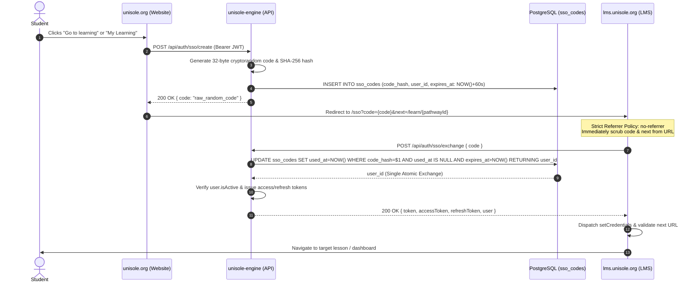

# Single Sign-On (SSO) Architecture & Integration Guide

## 1. Overview
This document specifies the cross-application Single Sign-On (SSO) mechanism enabling students authenticated on the public website (`unisole.org` / `unisole-seo`) to seamlessly transition into the Student LMS portal (`lms.unisole.org` / `unisole-lms`) without re-entering credentials.

Both applications share the same backend engine (`unisole-engine`) and PostgreSQL database (`users` table). Session management uses JSON Web Tokens (JWT) in client `localStorage` with zero cookies and no shared-origin CORS modifications.

---

## 2. SSO Protocol & Handoff Sequence



---

## 3. SSO API Endpoints

### 3.1 Create SSO Authorization Code
- **Method & Route:** `POST /api/auth/sso/create`
- **Authentication:** Required (`Authorization: Bearer <token>`)
- **Rate Limit:** 10 requests per 10 minutes per user ID (`keyGenerator: sso_create:user:{userId}`)
- **Payload:** None
- **Response (200 OK):**
```json
{
  "code": "A_BASE64URL_32BYTE_CRYPTOGRAPHIC_RANDOM_STRING"
}
```
- **Security:**
  - Raw code is never stored in the database.
  - SHA-256 hash is computed and stored in `sso_codes.code_hash`.
  - Expiry is set to strictly 60 seconds from creation.

### 3.2 Exchange SSO Code for Session Tokens
- **Method & Route:** `POST /api/auth/sso/exchange`
- **Authentication:** Public
- **Rate Limit:** 30 requests per 10 minutes per client IP (`keyGenerator: sso_exchange:ip:{ip}`)
- **Request Body:**
```json
{
  "code": "A_BASE64URL_32BYTE_CRYPTOGRAPHIC_RANDOM_STRING"
}
```
- **Response (200 OK):**
```json
{
  "token": "eyJhbGciOiJIUzI1NiIsIn...",
  "accessToken": "eyJhbGciOiJIUzI1NiIsIn...",
  "refreshToken": "eyJhbGciOiJIUzI1NiIsIn...",
  "user": {
    "id": "usr_...",
    "phone": "+919876543210",
    "name": "Alex Sharma",
    "role": "STUDENT",
    "isActive": true
  }
}
```
- **Concurrency & Replay Defense:**
  Uses atomic single-statement consumption:
  ```sql
  UPDATE sso_codes
  SET used_at = NOW()
  WHERE code_hash = $1
    AND used_at IS NULL
    AND expires_at > NOW()
  RETURNING user_id;
  ```
  If zero rows are modified, access is denied immediately with generic `401 Unauthorized` (`"Invalid or expired login code"`).

---

## 4. Environment Variables Specification

No domain or hostname is hardcoded. Environments differ solely by configuration variables.

| Environment Variable | Service | Staging Value | Production Value | Purpose |
| :--- | :--- | :--- | :--- | :--- |
| `VITE_LMS_URL` | `unisole-seo` | `https://stg.lms.unisole.org` | `https://lms.unisole.org` | Target host for LMS handoff |
| `VITE_API_URL` | `unisole-seo` | `https://stg.engine.unisole.org` | `https://api.unisole.org` | Backend API origin |
| `VITE_WEBSITE_URL` | `unisole-lms` | `https://stg.unisole.org` | `https://unisole.org` | Reverse link to main portal |
| `VITE_API_BASE_URL` | `unisole-lms` | `https://stg.engine.unisole.org` | `https://api.unisole.org` | Backend API origin |
| `ENABLE_AUTO_ENROLL` | `unisole-engine` | `false` (or `true` for QA) | `false` | Gate auto-enrollment into paid courses |
| `OTP_PROVIDER` | `unisole-engine` | `FAST2SMS` (or `MOCK`) | `FAST2SMS` | External SMS/WhatsApp provider |
| `NODE_ENV` | `unisole-engine` | `staging` / `development` | `production` | Enforces production security gates |

---

## 5. Security & Defense In Depth

1. **Open Redirect Defense:**
   The `next` query parameter in `SsoExchangePage.tsx` is strictly validated:
   - Must start with a single `/`.
   - Must not start with `//`.
   - Must contain no scheme, protocol, colon (`:`), or backslash (`\`).
   - Must match the allowlist: `['/learn/', '/player/', '/pathways/', '/enrolled', '/dashboard']`.
   - Any violation redirects safely to `/dashboard`.

2. **Zero URL Leakage:**
   - `<meta name="referrer" content="no-referrer">` is dynamically injected upon mounting `/sso`.
   - `window.history.replaceState({}, document.title, window.location.pathname)` immediately strips `code` and `next` from the browser address bar and history before token exchange starts.

3. **Production Safety Gates:**
   - **Mock OTP (1234):** Blocked unconditionally when `NODE_ENV === "production"`.
   - **Roadshow Bypass:** Disabled when `NODE_ENV === "production"`.
   - **Demo User Fallback (`usr_aarav_sharma_demo`):** Never generated on database connection failures in production; raises 503 instead of creating synthetic sessions.
   - **Mock Gateway:** Endpoint `/api/auth/mock-delivery-gateway` returns 404 in production.
   - **Auto-Enrollment:** Unenrolled users will not receive automatic free enrollment in `cs-agentic` unless `ENABLE_AUTO_ENROLL=true` is explicitly set.

---

## 6. Production Merge & Deployment Checklist

- [ ] **Database Migration:** Verify table `sso_codes` exists and indexes `uq_sso_codes_code_hash`, `idx_sso_codes_user_id`, `idx_sso_codes_expires_at` are created (handled automatically by `initializeDatabase()`).
- [ ] **Engine Environment:**
  - [ ] Set `NODE_ENV=production`.
  - [ ] Set `ENABLE_AUTO_ENROLL=false`.
  - [ ] Set `OTP_PROVIDER=FAST2SMS` with valid `FAST2SMS_API_KEY` and `FAST2SMS_WHATSAPP_MESSAGE_ID`.
- [ ] **Website (`unisole-seo`) Environment:**
  - [ ] Set `VITE_LMS_URL=https://lms.unisole.org`.
  - [ ] Set `VITE_API_URL=https://api.unisole.org`.
- [ ] **LMS (`unisole-lms`) Environment:**
  - [ ] Set `VITE_WEBSITE_URL=https://unisole.org`.
  - [ ] Set `VITE_API_BASE_URL=https://api.unisole.org`.
  - [ ] Verify production bundle size remains under 115 kB gzip.
- [ ] **Smoke Test:**
  - [ ] Log in on `https://unisole.org` using phone + WhatsApp OTP.
  - [ ] Navigate to `/profile` and click "Go to learning".
  - [ ] Confirm seamless transition into `https://lms.unisole.org/learn/cs-agentic` without code visible in URL bar.
  - [ ] Confirm open redirect attempt `https://lms.unisole.org/sso?code=...&next=https://evil.com` safely routes to `/dashboard`.
